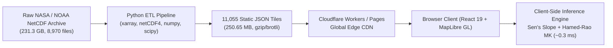

# TrendTrace: Be An Earth System Trend Detective!

[](https://www.spaceappschallenge.org/)
[]()
[](https://trendtrace.earth-trend-detective-frontend.workers.dev)
[]()
[]()

> **Click anywhere on Earth. See what is changing, where, by how much, and whether it is statistically significant.**

TrendTrace is an interactive 3D Earth system exploration application built for the **2026 NASA Space Apps Challenge: *Be An Earth System Trend Detective!*** Powered by 40+ years of NASA Earth science satellite observations and reanalysis models, TrendTrace runs complete non-parametric statistical trend analysis directly in the browser with **zero backend server required**.

---

## 🚀 Quick Links

- **🌐 Live Web Application:** [https://trendtrace.earth-trend-detective-frontend.workers.dev](https://trendtrace.earth-trend-detective-frontend.workers.dev)
- **🎬 Interactive Present Mode (Guided Demo):** [https://trendtrace.earth-trend-detective-frontend.workers.dev/?present=1](https://trendtrace.earth-trend-detective-frontend.workers.dev/?present=1)
- **📑 7-Slide Presentation Deck (PDF):** [deck/TrendTrace.pdf](file:///C:/Users/Gurshmeer%20Singh/orca/workspaces/earth-trend-detective/integrate/deck/TrendTrace.pdf) *(or view on [GitHub](https://github.com/singhg349-wq/earth-trend-detective/blob/main/deck/TrendTrace.pdf))*
- **💻 GitHub Repository:** [https://github.com/singhg349-wq/earth-trend-detective](https://github.com/singhg349-wq/earth-trend-detective)

> [!TIP]
> **For NASA Judges & Evaluators:** Click the **Present** button in the top navigation bar of the live website (or visit the URL with `?present=1`) to launch a guided, interactive 7-scene presentation. It walks through key climate cases (Alberta warming, Amazon drying, Jakarta haze, Indonesian rainfall teleconnections) with smooth 3D globe camera transitions, data cards, and statistical diagnostics synchronized with our 7-slide pitch deck!

---

## 🌍 The Problem & Our Solution

A short, noisy line on a chart proves nothing on its own. In Earth system science, climate records suffer from strong serial autocorrelation, multi-year natural variability (like the El Niño–Southern Oscillation), and sensor calibration shifts. Too often, public climate tools either oversimplify trends without statistical significance or require complex, slow Python server environments.

**TrendTrace solves this by combining massive NASA data preprocessing with instant in-browser statistical inference:**
1. **Precomputed Global Tiles:** We distilled **231.3 GB across 8,970 raw NetCDF files** down to **11,055 compact JSON tiles (250.65 MB)** covering the entire planet at 1° × 1° resolution across 5 seasonal slices (`ANN`, `DJF`, `MAM`, `JJA`, `SON`).
2. **Instant Browser Inference (~0.3 ms):** When you click anywhere on the globe, the client calculates Sen's slope, Hamed–Rao autocorrelation-corrected Mann–Kendall p-values, and Yue–Wang prewhitening sensitivity checks locally in ~0.3 milliseconds.
3. **Transparent Scientific Honesty:** If autocorrelation is present, we state it. If a user selects a custom year range, we show descriptive slopes and means while withholding p-values to prevent sub-period p-hacking.

---

## 🛰️ NASA Earth Science Datasets Used

TrendTrace integrates four core NASA Earth science products spanning 1980 to 2026, paired with NOAA sea-surface temperatures:

| Metric | Dataset Name & Level | Coverage | Resolution | Role in TrendTrace | DOI / Reference |
|---|---|---|---|---|---|
| **Rainfall** | **NASA GPCP v3.3** Monthly Analysis (`sat_gauge_precip`) | 1983–2025 (43 yrs) | 1.0° (native 0.5°) | Global 1° tiles, 10 regional series, 5 seasonal timelapses, DJF/JJA ENSO impact maps | [`10.5067/MEASURES/GPCP/DATA306`](https://doi.org/10.5067/MEASURES/GPCP/DATA306) |
| **Temperature** | **NASA MERRA-2 `M2TMNXSLV` v5.12.4** (2 m Air Temp, `T2M`) | 1980–2026 (47 yrs) | 1.0° (native 0.5° × 0.625°) | Global 1° temperature tiles, 10 regional series, 5 seasonal timelapses, DJF/JJA ENSO impact maps | [`10.5067/AP1B0BA5PD2K`](https://doi.org/10.5067/AP1B0BA5PD2K) |
| **Aerosols (Haze)** | **NASA MERRA-2 `M2TMNXAER` v5.12.4** (550 nm AOD, `TOTEXTTAU`) | 1980–2026 (47 yrs) | 1.0° (native 0.5° × 0.625°) | Global 1° aerosol tiles, 10 regional series, 5 seasonal timelapses, SON ENSO impact map | [`10.5067/FH9A0MLJPC7N`](https://doi.org/10.5067/FH9A0MLJPC7N) |
| **Soil Moisture** | **NASA GLDAS Noah v2.1** Land Surface Model L4 (`SoilMoi0_10cm`) | 2000–2026 (27 yrs) | 1.0° (land only) | 1,335 global land tiles, 10 regional series, 5 timelapses (2001–2020 baseline), DJF ENSO map | [`10.5067/LWTYSMP3VM5Z`](https://doi.org/10.5067/LWTYSMP3VM5Z) |
| **SST Anomaly & Climatology** | **NOAA ERSST v6** Global Sea Surface Temp | 1979–2026 (574 mo) | 2.0° | 574 monthly transparent SST anomaly frames, 12-month normal year climatology (1991–2020) | [`10.1175/JCLI-D-23-0707.1`](https://doi.org/10.1175/JCLI-D-23-0707.1) |
| **ENSO Index** | **NOAA CPC Relative Oceanic Niño Index (RONI & ONI)** | 1950–2026 (921 sea) | Regional | 921 3-month running seasons, 44 qualifying warm/cold episodes, detrended composite masks | NOAA Climate Prediction Center |

### 🔬 Scientific Honesty Notes
- **Aerosol Observational Homogeneity:** MERRA-2 assimilates NASA MODIS aerosol optical depth starting around year 2000. Prior to 2000, land AOD estimates are predominantly model-driven. TrendTrace clearly notes this observational boundary in aerosol inspector panels.
- **GLDAS Soil Moisture Splice Audit:** GLDAS v2.0 (1948–2014) and v2.1 (2000–present) overlap between 2000 and 2014. Our audit revealed a systematic `+0.469 kg/m²` calibration offset and `3.75 kg/m²` spatial RMSE between versions. Rather than artificially splicing the series and introducing a false trend, we intentionally withheld v2.0 and present the homogeneous 2000–2026 v2.1 record.

---

## 📊 Statistical Rigor & Methodology

TrendTrace implements a multi-stage statistical pipeline to ensure trends reflect physical change rather than noise or autocorrelation:

1. **Sen's Slope Estimator:** The median slope across all pairwise year combinations ($N(N-1)/2$ pairs), providing robust trend rates insensitive to extreme outliers.
2. **Mann–Kendall Non-Parametric Trend Test:** Rank-based evaluation of monotonic trends over time.
3. **Hamed & Rao (1998) Autocorrelation Correction:** Accounts for serial correlation across up to 3 lags ($\rho_1, \rho_2, \rho_3$), computing an effective sample size $n^*$ to prevent false-positive significance in persistent climate series.
4. **Yue & Wang (2004) Prewhitening Check:** Sensitivity test removing AR(1) autoregressive components before testing to confirm slope robustness.
5. **Configurable Significance Strictness:** Users can filter global overlays and diagnostics across $p < 0.01$ (high confidence), $p < 0.05$ (standard), or $p < 0.10$ (exploratory).
6. **False Discovery Rate (FDR):** Global trend overlays use Benjamini–Hochberg FDR control ($q = 0.10$) to hatch cells that remain statistically significant under multiple hypothesis testing.
7. **Custom Year Range (Option A):** Users can highlight any sub-period (e.g., 2000–2025). The app displays descriptive Sen slopes and means, but intentionally suppresses p-values to prevent sub-period p-hacking.
8. **Parity Testing & Giovanni Verification:**
   - **26/26 parity tests:** Comprehensive unit test suite guaranteeing that browser TypeScript calculations match Python Scipy/Statsmodels reference implementations down to $10^{-6}$.
   - **NASA Giovanni Cross-Check:** GPCP regional rainfall trends were checked against NASA Giovanni reference extractions for Peru and Indonesia to validate our spatial aggregation and temporal weights.

---

## 🌊 El Niño & Natural Variability Explorer

Detecting decadal trends requires understanding the dominant modes of interannual climate variability:
- **921 Three-Month Seasons (1950–2026):** NOAA RONI records showing 44 warm and cold events, highlighting major historical El Niño events (1982–83 at +2.40 °C, 1997–98 at +2.28 °C, and 2015–16 at +2.25 °C).
- **574 Monthly Global SST Rasters:** High-performance canvas-rendered Sea Surface Temperature anomalies from NOAA ERSST v6 (1979–2026).
- **1991–2020 Normal-Year Climatology:** A 12-month baseline cycle showing regular seasonal temperature evolution.
- **Six Detrended Composite Impact Maps:** Linear-detrended El Niño minus La Niña composite differences (`precip_DJF`, `t2m_DJF`, `aod_SON`, `precip_JJA`, `t2m_JJA`, `sm_DJF`) validated with 2,000 Monte Carlo permutations and Benjamini–Hochberg FDR hatching. Always framed as **associated with, not caused by**.

---

## 🛠️ Tech Stack & Architecture



- **Frontend:** React 19, TypeScript, Vite, MapLibre GL, WebGL canvas overlays.
- **Deployment:** Cloudflare Workers / Pages edge CDN (`frontend/wrangler.jsonc`).
- **Data Engineering:** Python 3.12, xarray, netCDF4, SciPy, pandas, Pillow, python-pptx.
- **Testing:** Vitest (317 tests passing), Pytest (180 tests passing), automated parity verification.

---

## 📁 Repository Layout

```
earth-trend-detective/
├── frontend/                     # React 19 + TypeScript web application
│   ├── src/
│   │   ├── components/           # GlobeView, Inspector, WhyCard, Timelapse, etc.
│   │   ├── lib/                  # Statistical tests (Sen slope, Hamed-Rao, Yue-Wang)
│   │   ├── pages/                # GlobePage, EnsoPage, GlossaryPage
│   │   ├── present/              # Interactive 7-scene Present mode
│   │   └── data/                 # Grid decoders, anomaly rasters, diagnostics
│   ├── public/                   # Static icons, gazetteer, and manifests
│   └── wrangler.jsonc            # Cloudflare deployment configuration
├── backend/                      # Optional Python FastAPI reference service
├── scripts/                      # Data processing, tile generation, and validation
│   ├── extract_tiles.py          # NetCDF to compact 1° JSON tile generator
│   ├── verify_parity.py          # Python vs TypeScript statistical parity test
│   └── build_enso_assets.py      # ERSST SST anomaly & composite map builder
├── deck/                         # Presentation assets
│   ├── TrendTrace.pdf            # Official 7-slide NASA Space Apps presentation
│   ├── TrendTrace.pptx           # Animated presentation with PowerPoint Morph
│   └── build_decks.py            # Automated OOXML deck generation script
├── docs/                         # Scientific documentation & submission
│   ├── submission/               # NASA Space Apps submission texts & forms
│   │   ├── READY_TO_PASTE_FORM.md# Complete ready-to-paste submission form
│   │   ├── 01_summary.md         # Official 200-word summary
│   │   ├── 02_project_description.md # Official 3000-character description
│   │   └── 03_data_credits_and_ai_disclosure.md # DOIs, credits & AI disclosure
│   └── SOURCES.md                # Data acquisition guides and checksums
└── tests/                        # Python statistical test suite
```

---

## 💻 Local Development Setup

To run TrendTrace locally on your machine:

### Prerequisites
- Node.js (v20+ recommended)
- npm

### 1. Clone & Install
```bash
git clone https://github.com/singhg349-wq/earth-trend-detective.git
cd earth-trend-detective/frontend
npm install
```

### 2. Start the Development Server
```bash
npm run dev
```
Open your browser at `http://localhost:5173`. Add `?present=1` to immediately jump into Present mode!

### 3. Run Test Suite
```bash
npm run test
```
Runs 317 unit and parity tests verifying statistical math, grid indexing, and UI logic.

---

## 📜 Scientific Disclaimers & Credits

- **Data Attribution:** All data products are public Earth science observations and reanalyses provided by NASA Goddard Earth Sciences Data and Information Services Center (GES DISC) and NOAA Climate Prediction Center. Zero official endorsement by NASA, NOAA, or any government agency is implied.
- **Climate Trend Attribution:** Statistical trend detection identifies significant multi-decadal changes in observational time series; correlation with climatic indices describes statistical association, not deterministic physical causation.
- **AI Disclosure:** AI coding assistants were utilized for scaffolding frontend components, packaging scripts, and test suites. All data calculations, statistical algorithms, parity verifications, and scientific interpretations were validated locally by team members.

---

**Team One — NASA Space Apps Challenge 2026**
